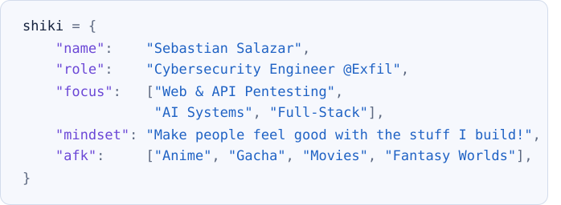
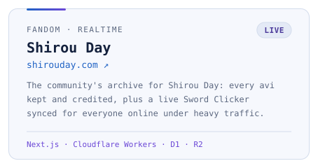
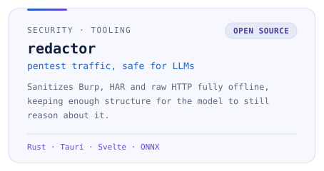
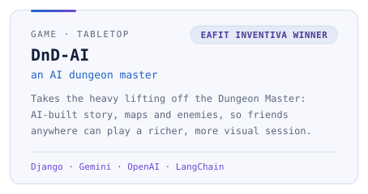
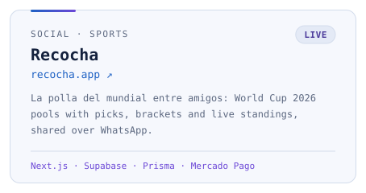

<picture>
  <source media="(prefers-color-scheme: dark)" srcset="assets/banner-dark.svg">
  
</picture>

&nbsp;&nbsp;&nbsp;
&nbsp;&nbsp;&nbsp;

## `> whoami`

<picture><source media="(prefers-color-scheme: dark)" srcset="assets/whoami-dark.svg"></picture>

A **security engineer with a developer's brain** and a designer's eye. By day I break enterprise web apps and APIs: auth flows, authorization logic, long API chains. The rest of the time I build things that look and feel good.

## `> arsenal`

<picture>
  <source media="(prefers-color-scheme: dark)" srcset="https://skillicons.dev/icons?i=py,ts,rust,java,cpp,react,nextjs,svelte,threejs,tailwind,fastapi,nestjs,django,postgres,supabase,redis,docker,aws,gcp,cloudflare&perline=10&theme=dark">
  
</picture>

**🔐 Security:** web, API, mobile & thick-client pentesting · authn/authz bypass · business logic · vulnerability chaining · prompt injection · Burp Suite Pro

<b>full inventory</b>

 

| | |
|---|---|
| **Languages** | Python · TypeScript · JavaScript · Rust · C# · Java · C · C++ · R |
| **Frontend** | React · Next.js · Angular · Svelte · Three.js / R3F · GSAP · Framer Motion · Tailwind |
| **Backend** | FastAPI · Django · Flask · NestJS · Express · gRPC |
| **Data** | Postgres · MongoDB · MySQL · SQLite · DynamoDB · Supabase · Redis · Prisma · BigQuery |
| **Cloud & Ops** | AWS (ECS, EKS, Lambda, S3, IAM, VPC, KMS) · GCP (Cloud Run, Cloud Build) · Cloudflare (Workers, D1, R2, Durable Objects, Images, Turnstile) · Docker · Kubernetes · Terraform · Helm · GitHub Actions |
| **AI & Data** | LangChain · LangGraph · LlamaIndex · RAG · OpenAI · Anthropic · Kafka · Spark · scikit-learn · spaCy · Presidio |
| **Observability** | Prometheus · Grafana · Loki · OpenSearch |
| **Networking** | TCP/IP · MQTT · sockets · OSPF · RIPv2 · NAT/PAT · VLSM |

## `> projects`

<a href="https://shirouday.com"><picture><source media="(prefers-color-scheme: dark)" srcset="assets/cards/shirou-day-dark.svg"></picture></a><a href="https://github.com/Sebasalazaro/redactor"><picture><source media="(prefers-color-scheme: dark)" srcset="assets/cards/redactor-dark.svg"></picture></a> <a href="https://github.com/Sebasalazaro/DnD-AI"><picture><source media="(prefers-color-scheme: dark)" srcset="assets/cards/dnd-ai-dark.svg"></picture></a><a href="https://recocha.app"><picture><source media="(prefers-color-scheme: dark)" srcset="assets/cards/recocha-dark.svg"></picture></a>

**Client Work**

- **Real estate presale platforms (×2):** scroll-driven sites with 3D scenes, unit explorers, 360° tours and lead capture, built so investors can walk a residential project from anywhere.
- **ChupoStore:** e-commerce for a paint-removal brand. Next.js + NestJS monorepo with PlaceToPay checkout and server-to-server payment verification.
- **DMOps:** project management platform for an electrical design firm: projects, milestones, tasks, teams and roles.

**More** · [Poneglyph Reduce](https://github.com/Sebasalazaro/Poneglyph-Reduce) · [Sentinel](https://github.com/Sebasalazaro/Sentinel) · [vigilante](https://github.com/Sebasalazaro/vigilante) · [wikiria](https://github.com/Sebasalazaro/wikiria) · [FakeNewsDetection](https://github.com/Sebasalazaro/FakeNewsDetection)

 

*"It would be such a waste to worry yourself on a day like this."*

